


<a href="https://www.linkedin.com/in/marlon-pinpin/">LINKEDIN</a>



<picture><source media="(prefers-color-scheme: dark)" srcset="https://raw.githubusercontent.com/CheonMarlon/CheonMarlon/output/snake-dark.svg"><source media="(prefers-color-scheme: light)" srcset="https://raw.githubusercontent.com/CheonMarlon/CheonMarlon/output/snake-light.svg"></picture>



